# VierVideo

An HTML-to-video editor and narration studio for Windows, developed by [VierApparatus](https://www.vierapparatus.com). It takes an HTML animation (usually one an AI assistant wrote) and lets you **inspect it, change individual parts of it without editing code, add layers, narrate it with a local text-to-speech voice, and export an MP4**. Everything runs on your own computer: no account, no paid video service.

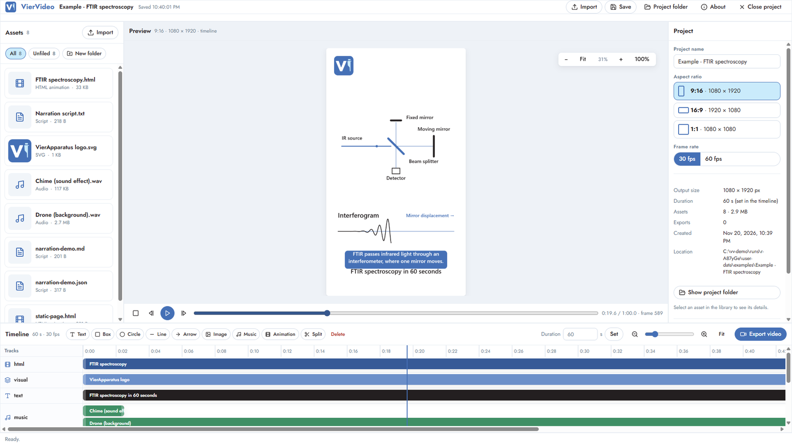

## Why it exists

AI assistants can write an animation as HTML, CSS and JavaScript. That is a cheap way to make a video, but it leaves five practical problems:

| Problem | What VierVideo does about it |
|---|---|
| **Small changes mean editing code, or asking the AI to regenerate everything.** | The studio lets you click a part of the animation and drag it, or add text, shapes, images and HTML elements as layers on a timeline. The animation file is not changed. |
| **Finding which element causes a visual bug means reading several files.** | Click a part: the studio shows what it is (its kind, text, box) and, for DOM elements, the lines of source that name it. "Developer tools for the animation" (View menu) opens the animation in its own window with Chromium's tools. |
| **HTML has no audio workflow.** | Narration from a script with a local Kokoro voice, plus music and sound effects on timeline tracks, mixed into the MP4. |
| **Paid generators cost money for every revision.** | Rendering, narration and mixing are local (Electron, Python, FFmpeg). |
| **Editing, checking and exporting is slow.** | The preview draws the same frames the export uses, so what you see at a time is what is exported at that time. |

## Screenshots (from the running application)

All screenshots are of the real built app, running the example project that ships with it (an FTIR spectroscopy animation). They were captured by driving the app over the DevTools protocol; nothing is a mock-up.

| | |
|---|---|
| 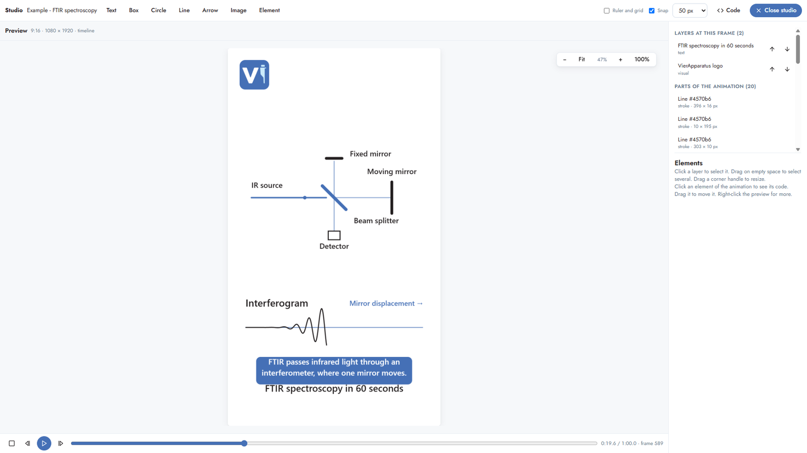 **Studio.** A large view of the same frame, with the layers at the playhead and the "parts of the animation" list. | 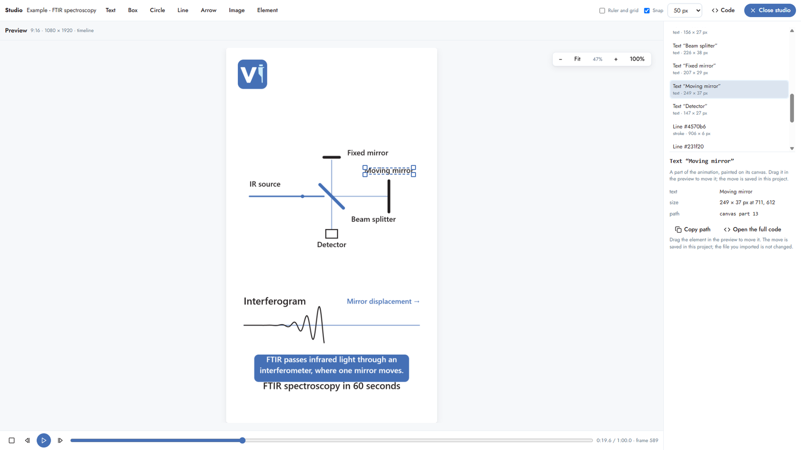 **Inspecting a part.** "Moving mirror" is a text painted on a canvas; the studio shows its box and its place in the canvas. |
| 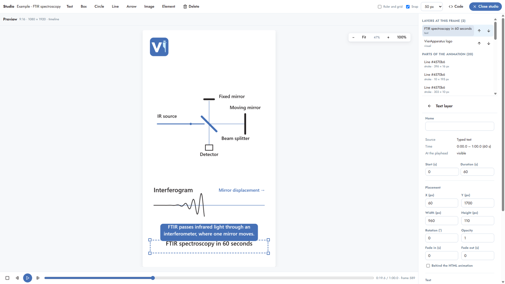 **A layer.** The caption is a timeline layer with a position, size, rotation, opacity and fades. | 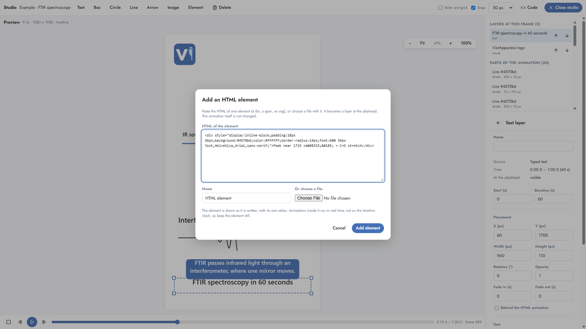 **Adding an HTML element.** Paste the HTML of one element (or choose a file). It becomes a layer at the playhead. |
| 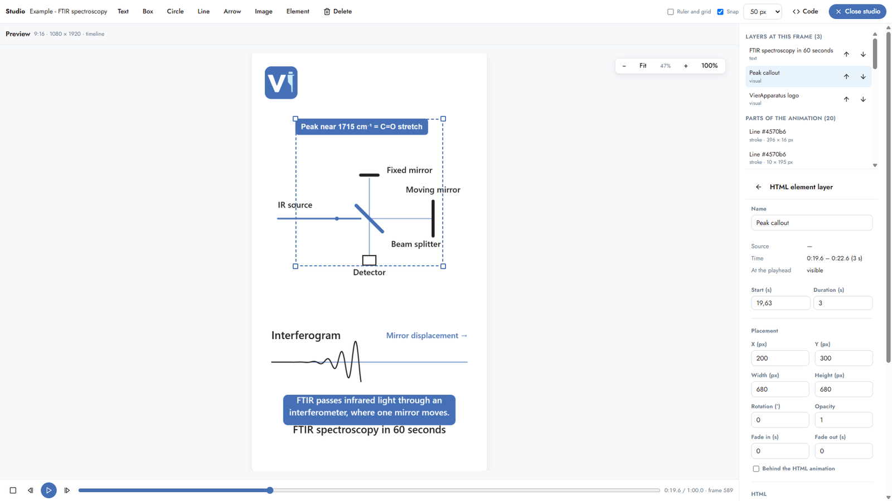 **The element as a layer.** It is drawn over the animation; the animation's own file is untouched. |  **Moving a part.** The "Detector" label was dragged; the move is stored in the project, not in the animation. |
| 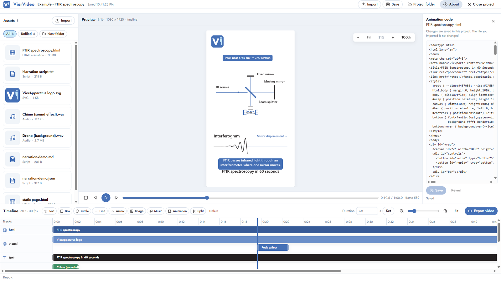 **Animation code.** The animation's HTML can be read and edited (the first edit keeps `<file>.original`). | 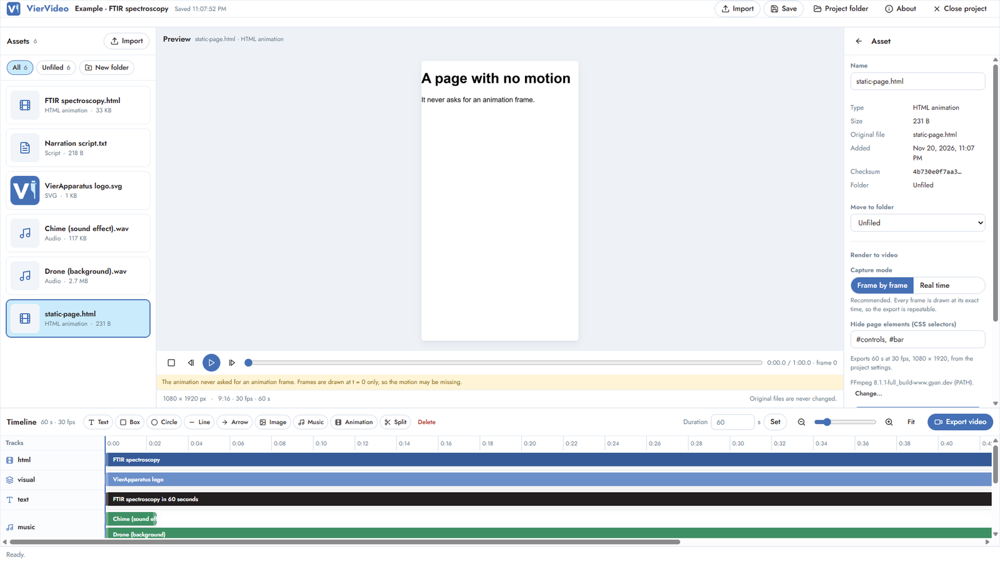 **Render check.** A page that never asks for an animation frame gets a warning in the preview. |
| 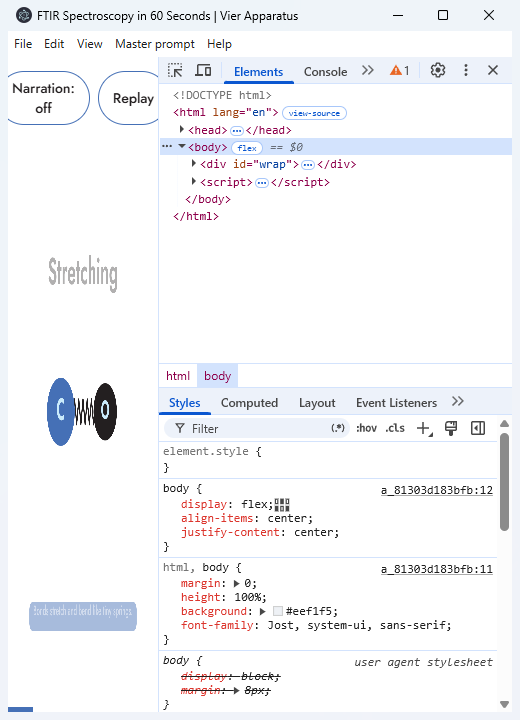 **Developer tools for the animation.** Its own window with Chromium DevTools. | 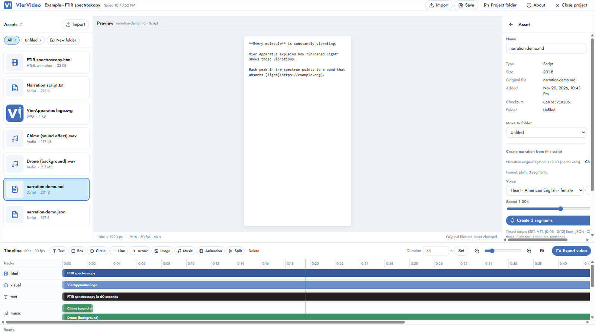 **Markdown script.** Format "plain": markdown marks are removed before the text is spoken. |
| 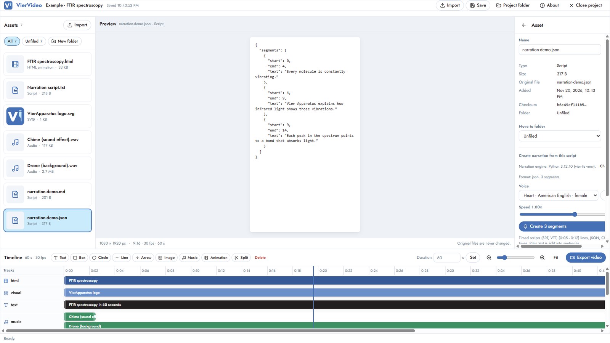 **JSON script.** Format "json", three timed segments. | 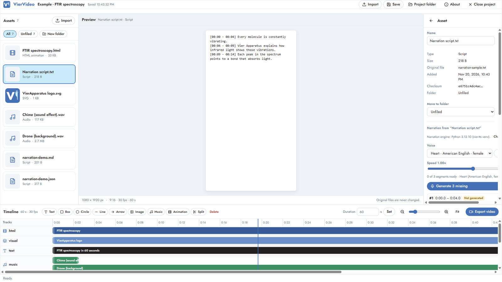 **TXT script.** Timed lines such as `[00:04 - 00:09] text`. |
| 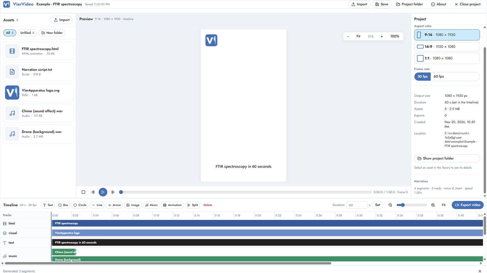 **Narration.** Segments generated with the local voice ("3 segments, 3 ready"). | 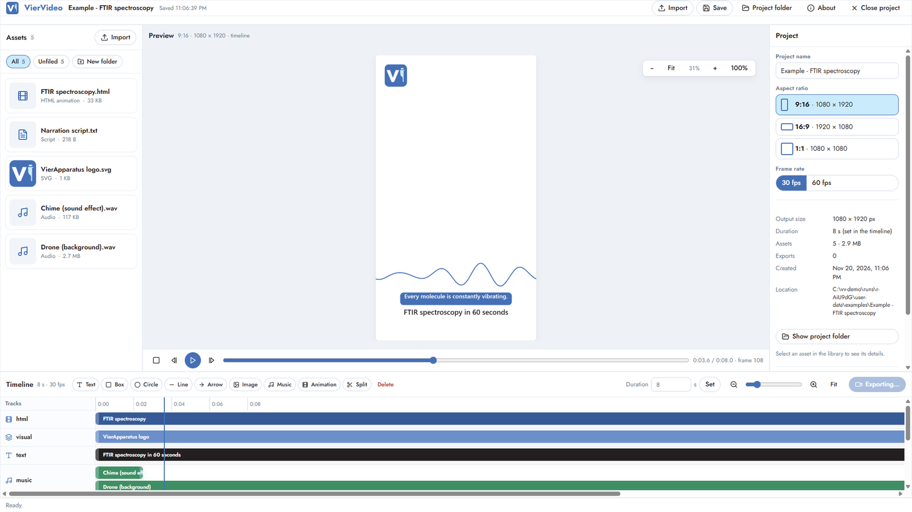 **Export running.** An 8-second clip; the button shows "Exporting...". |
| 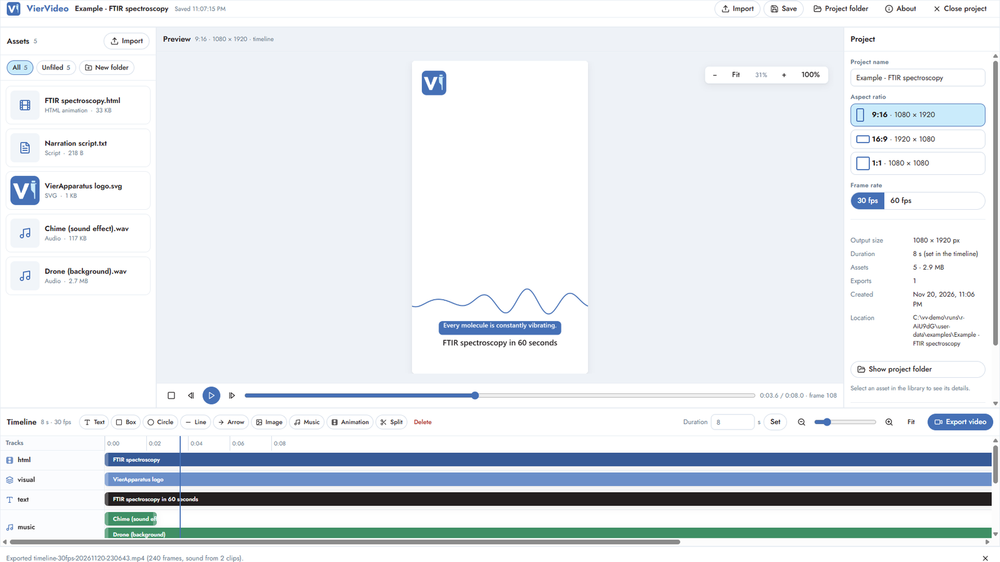 **Export finished.** The status line reports the frame count and the clips mixed (240 frames, sound from 2 clips). | |

## Features (implemented and tested)

- **Projects.** A project is a folder with `project.vvproj.json` and an `assets/` folder. Imported files are copied (identical files are stored once, by SHA-256); the originals are never changed. Changes are saved at once and atomically, with a `.bak` copy.
- **Import.** Images (PNG, JPG, WebP, GIF), SVG, HTML animations, scripts (TXT, Markdown, JSON, CSV) and audio (MP3, WAV, M4A, OGG). MP4, WebM and MOV files can be imported into the library.
- **Timeline.** Five tracks: `html`, `visual`, `text`, `narration`, `music`. Clips move freely, overlapping clips stack in rows, clips can be split, grouped (Ctrl+G) and ungrouped (Ctrl+Shift+G).
- **Studio.** Click a part of the animation to select it and drag to move it. Draw a selection rectangle to pick several layers; resize with the corner handles; optional ruler, grid and snapping; a layer list with bring forward / send backward.
- **Parts of a canvas animation.** Many animations draw everything on one `<canvas>`, so the browser sees a single element. A canvas recorder wraps the drawing calls and records every paint call of each frame (kind, text or colour, box), so individual parts can be picked and moved.
- **HTML element layers.** Paste the HTML of one element. It is sanitised (comments, scripts, frames, plugins, event attributes and `javascript:` addresses are removed) and drawn in a shadow root over the animation.
- **Code view.** Read and edit the animation's source; restore the imported original.
- **Development mode.** View > "Developer tools for the animation" opens the animation's own page in a window with DevTools. "Developer tools for the app" is a separate menu item.
- **Narration.** Scripts become timed segments: TXT with `[00:04 - 00:09]` ranges (SRT and WebVTT cue timing is also recognised inside a text file), JSON, CSV, Markdown and plain prose. Eight Kokoro-82M voices, speed 0.7x to 1.3x. Runs on the CPU, offline after the first model download. "Vier" is spoken as "veer" (rules in `tools/tts/pronunciations.json`).
- **Sound.** Music and sound-effect clips with volume and fades; one FFmpeg filter graph mixes narration and music.
- **Export.** MP4, H.264 (`libx264`, `yuv420p`, CRF 18) with AAC audio (192 kbps, 48 kHz). Aspect ratios 9:16 (1080x1920), 16:9 (1920x1080) and 1:1 (1080x1080); 30 or 60 fps. The default capture is frame by frame on a virtual clock; a "real time" capture mode exists for animations that need it.
- **Master prompt.** A built-in brief you can paste into an AI assistant so the HTML it writes fits how the app reads it (`electron/assets/master-prompt.md`).

## Architecture

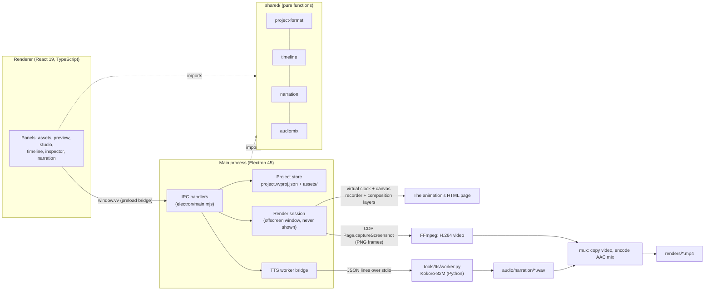

How a frame is made:

1. The animation's page is loaded in an offscreen Electron window. A **virtual clock** is injected before the page's own scripts run, replacing `requestAnimationFrame`, timers, `Date` and `Math.random`. `advance(ms)` moves time forward, so the same time always gives the same picture (repeat exports are compared with PSNR >= 45 dB).
2. The timeline's layers (text, images, shapes, HTML elements) are drawn over the page as DOM elements by `electron/lib/render/composition.mjs`.
3. The frame is captured over the DevTools protocol and sent to FFmpeg's stdin. The preview uses the same path, one frame at a time.
4. Narration and music clips become one FFmpeg filter graph (`shared/audiomix.mjs`): trim, volume, fade, delay, `amix`, pad, limit. The video stream is copied and the mix is encoded as AAC.

Boundaries: the renderer never receives file paths except through IPC. Project files are served through custom schemes (`vvapp://`, `vvasset://`, `vvproj://`, `vvfont://`), and a project's media is only reachable from inside its own `audio/` and `renders/` folders.

More detail: [docs/how-the-app-works.md](docs/how-the-app-works.md) (developer description) and [docs/PLAN.md](docs/PLAN.md) (audit, decisions, stages and test results).

## Run it

Requirements: Windows 10 or 11, Node.js (developed with v24), and FFmpeg (set in the app, in `VIERVIDEO_FFMPEG`, or on the PATH). Narration is optional and needs Python 3.10 to 3.12.

```powershell
npm install
npm start            # type-checks, builds the renderer and starts Electron
```

On the first start the app creates and opens an example project in `%USERPROFILE%\VierVideo`.

**Narration engine (optional).** `tools/tts/setup-narration.ps1` creates a Python environment in `%LOCALAPPDATA%\vier-tts` and downloads the Kokoro-82M model. The first generation after each start takes about a minute and a half while the model loads.

## Tests

```powershell
npm test               # unit tests (Vitest): 166 passing when this repository was published
npm run typecheck
npm run e2e:stage1     # drives the built app over the DevTools protocol (build first)
npm run e2e:stage5     # real narration and export; checks the MP4's audio (needs ffprobe)
```

The end-to-end tests start the real Electron app and use `playwright-core`. Each uses its own debugging port and user-data folder.

## Limits and known gaps

- **No stand-alone HTML validator.** There is no separate "HTML check" tool. What exists: the render session warns when an animation never asks for an animation frame (motion would be missing), pasted HTML elements are sanitised, the code view lets you read and edit the source, and DevTools show errors.
- **Windows is the only tested platform** (the installer, taskbar handling and several tests use Windows features).
- **HTML elements are pictures.** An element layer is drawn at each frame without running its scripts, and its CSS animations run in real time, not on the timeline clock.
- **Canvas parts are picked by their box**, not their exact outline. A part that moves faster than its own size and 80 px a second is not followed across frames (section 12 of the developer description).
- **Groups are one level deep**; resize uses corner handles only (no rotation handle).
- **Export is MP4 only.** There is no stand-alone HTML export.
- **The Windows installer** (`npm run dist:win`) is not code-signed and has only been tested on the development machine. It bundles a GPL build of FFmpeg and carries a notice for it; this repository does not contain FFmpeg.

## Licence

Not yet decided.
